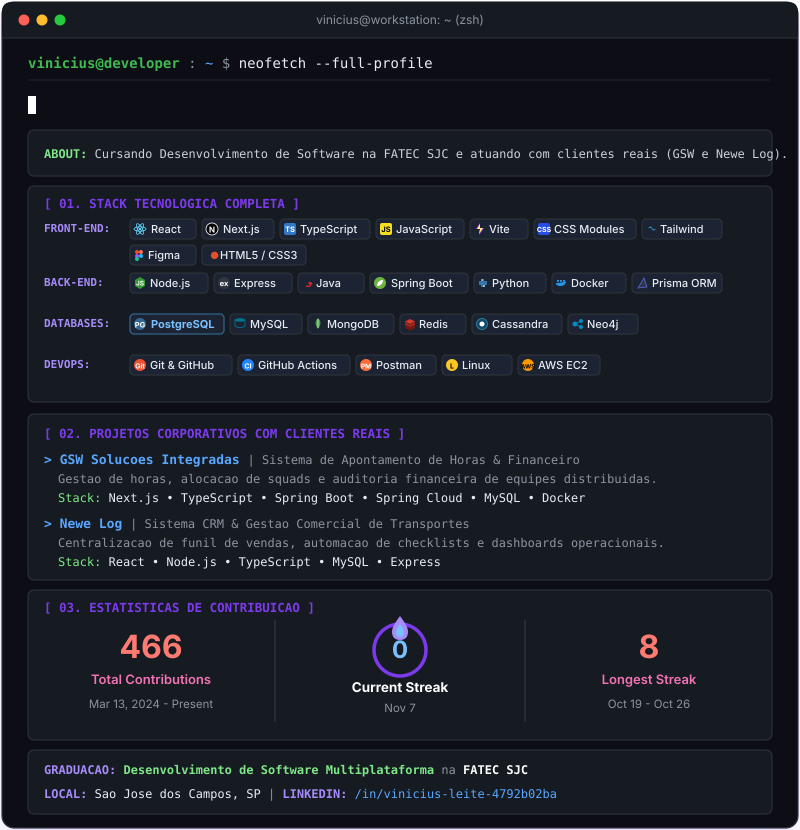

  <!-- CABEÇALHO MAC TERMINAL (Sem link cobrindo a imagem toda) -->
  

    

  <!-- LINKS E STATUS (Botões clicáveis individuais) -->
  
  
  

    

  <!-- ESCRITA DE APRESENTAÇÃO RESTAURADA -->
  

    <b>Full-Stack Developer com foco em Front-End.</b> Cursando Desenvolvimento de Software e atuando no desenvolvimento de soluções corporativas com clientes reais (<b>GSW Soluções Integradas</b> e <b>Newe Log</b>).
  

---

## Tecnologias

  

| Camada | Tecnologias |
| :--- | :--- |
| **Front-End** | React, Next.js, Vite, TypeScript, Tailwind CSS, CSS Modules, Figma |
| **Back-End** | Node.js, Spring Boot (Java), Spring Cloud, Python |
| **Bancos de Dados** | MySQL, MongoDB, Redis, Apache Cassandra, Neo4j |
| **DevOps & Ferramentas** | Docker, Git, GitHub Actions, Postman, Linux |

---

## Projetos com Clientes Reais

<table width="100%">
  <tr>
    <td width="50%" valign="top">
      <h3>GSW Soluções Integradas</h3>
      
<b>Sistema Corporativo de Apontamento de Horas</b>

      
Plataforma enterprise para centralizar o controle de horas, alocação de squads e auditoria financeira de equipes distribuídas pelo Brasil. Elimina inconsistências de planilhas com controle de perfis de acesso e relatórios em tempo real.

      

        
        
        
        
      

       
      
    </td>
    <td width="50%" valign="top">
      <h3>Newe Log</h3>
      
<b>Sistema CRM & Gestão Comercial</b>

      
Plataforma para centralizar o funil de vendas, automatização de checklists operacionais e gestão de clientes da transportadora. Reduz erros manuais e unifica dados antes dispersos em formulários avulsos.

      

        
        
        
      

       
      
    </td>
  </tr>
</table>

---

## Estatísticas de Desenvolvimento

  <!-- Estatísticas estáveis do Summary Cards (sem erro de PAT_1) -->
  
  

 

  <!-- Streak com tema dark/roxo ativo -->
  

